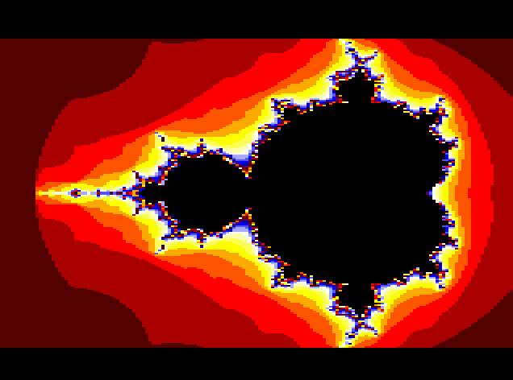
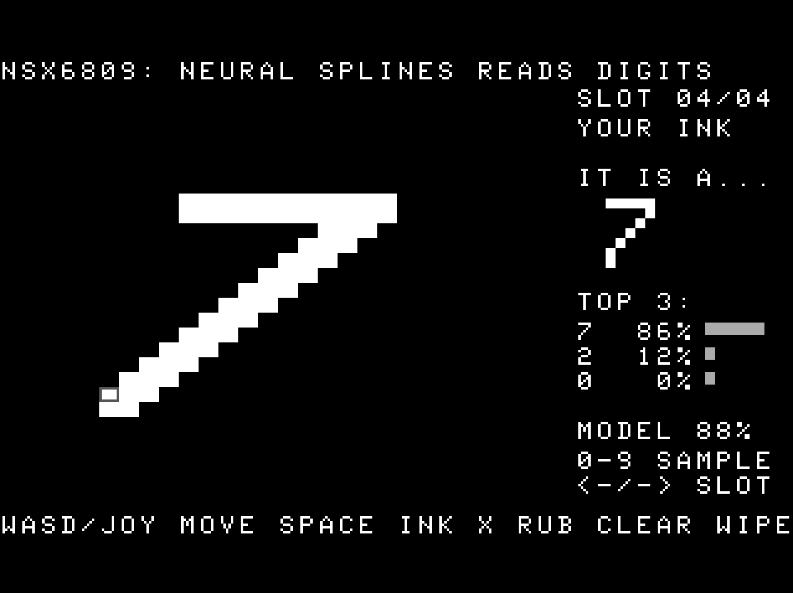

# coco3

```
DISK EXTENDED COLOR BASIC 2.1
COPR. 1982, 1986 BY TANDY
UNDER LICENSE FROM MICROSOFT
AND MICROWARE SYSTEMS CORP.
OK
LOADM"WOLF3D":EXEC
```

> *Field note, recovered from the third planet.* The natives built a machine in 1986 and sold it in their Radio
> Shacks: a Motorola 6809 at 1.79 MHz, a video chip they called GIME, 128 KB that the brave upgraded to 512 KB, and a
> green screen that said `OK` and waited. They wrote games for it in assembler, typed listings out of a magazine
> called *Rainbow*, and then, mostly, moved on. The visitor did not move on. The visitor wanted to know what the
> machine could have done if anyone had asked it nicely.

This is what it did.

| | Project | What the CoCo 3 does |
|---|---|---|
|  | [**wolf3d**](wolf3d/) | Wolfenstein 3D, full screen, real level, real art, real sound, plus an autopilot that plays it for you |
|  | [**fractals**](fractals/) | Nine fractals and an effects reel with no multiply in the inner loop, checked byte for byte against a reference |
|  | [**cubes**](cubes/) | A cube of dots turning into a solid shaded cube, with a three-voice soundtrack the CPU mixes live; one voice *is* the cube |
|  | [**nsx6809**](nsx6809/) | Learns to read handwritten digits (on its own CPU, in 35 minutes, 512 KB, integer only), then reads yours |
| | [**doom**](doom/) | not yet |

Short on time? [TLDR.md](TLDR.md) has the one-screen version. The landing page is [index.html](index.html).

## House rules (the 6809 way)
* **No division where it hurts.** Reciprocals, distances, perspective: worked out once into a table, then looked up.
* **Write the code that writes the code.** The Wolf3D engine generates about 150 column-drawing routines at boot.
  Straight-line stores beat any loop.
* **`PSHU` is a blitter.** `PULS A,B,X,Y` / `PSHU A,B,X,Y` moves six bytes in 22 cycles. Clears, fills and the
  status bar all ride the stack.
* **2 MB through an 8 KB keyhole.** The GIME's memory mapper swaps a page into view with one store. Everything big
  lives above 64 KB.
* **Draw less.** Interlaced rows, coarse-to-fine refinement, "this pixel looks like its neighbours" guessing, only
  the dirty rectangle cleared.
* **Bresenham everywhere.** Lines, texture steps, sound pitch, and even the learning rule in nsx6809: keep the
  fraction in an error term, and step when it spills over.
* **Trust nothing you haven't diffed.** Fractals, the cube's maths and the neural network all have a Python twin.
  The emulated CoCo's memory is dumped and compared byte for byte.

## Running any of it
Each folder stands alone: `./setup.sh` (or the README's list of tools), then `./run.sh`. They build real
Disk BASIC floppy images with `lwasm` (lwtools), boot them in MAME's CoCo 3, type the `LOADM` for you, and can
record what happens with `--video`. Every disk also runs on real hardware: copy the `.DSK` to a floppy or a
CoCoSDC and `LOADM` it.

Wolfenstein 3D needs **your own copy** of the game's data files; see [IP.md](IP.md). Everything else needs nothing
but the tools.

---

## On the bench: working on the inv sqrt hack, AI using real inference, and so on

```c
float Q_rsqrt( float number )
{
    long i;
    float x2, y;
    const float threehalfs = 1.5F;

    x2 = number * 0.5F;
    y  = number;
    i  = * ( long * ) &y;            // look at the float's bits as an integer
    i  = 0x5f3759df - ( i >> 1 );    // halve the exponent, and the magic number does the rest
    y  = * ( float * ) &i;
    y  = y * ( threehalfs - ( x2 * y * y ) );   // 1st iteration
//  y  = y * ( threehalfs - ( x2 * y * y ) );   // 2nd iteration, this can be removed

    return y;
}
```
*(From the Quake III Arena source, released by id Software under the GPL; the first two comments are ours, the
originals being less printable.)*

Every 3D engine wants 1/√x: to make a vector length one, to light a wall, to aim a monster. The textbook way costs
a square root and a division, two of the most expensive things a CPU can be asked to do. In 1999 *Quake III Arena*
shipped the routine above. It became famous in 2005, when id Software released the source and programmers found a
magic constant and a comment that can't be printed here.

The history is better than the hack.
* It wasn't John Carmack's, and he said so.
* Rys Sommefeldt and others went digging in 2006. The trail ran back through **Gary Tarolli** at 3dfx to **Greg
  Walsh** at Ardent Computer in the late 1980s, working with **Cleve Moler** (the creator of MATLAB).
* Moler's starting point was an unpublished 1986 note by **William Kahan and K.C. Ng** at Berkeley: square roots
  by the same kind of bit-fiddling, followed by Newton steps.
* In 2003 **Chris Lomont** worked out where `0x5f3759df` comes from, and found a constant that is very slightly
  better.

So it's a decade-older idea that kept being passed from hand to hand by people deciding **what to optimize and what to
drop**. Here, that's the second iteration commented out ("this can be removed"), a guess that is good enough instead
of exact, and the bits of a float read as if they were an integer.

The 6809 has no floating-point hardware at all. But Color BASIC carries its own five-byte floats (an exponent byte
above a four-byte mantissa), and the trick only needs the exponent to sit above the mantissa. So: the inverse
square root hack on a CoCo 3, real inference deciding what the monsters do (NSX6809 already runs a trained network
from a 4.7 KB program), and so on. See [doom/](doom/).

---

[LICENSE.md](LICENSE.md) (Clear BSD) · [PATENTS.md](PATENTS.md) (Neural Splines technology is patented: free for
personal, educational and non-commercial use) · [IP.md](IP.md) (whose is what: id Software, MNIST, Tandy) ·
[TLDR.md](TLDR.md)
