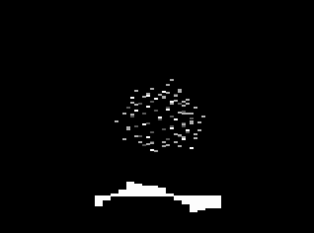

# CUBE — from dots to a solid cube, with music the CoCo plays live

A demo-scene style effect for the CoCo 3, in one source file you can read and change: `cube.asm`. A cube of dots
spins and goes wobbly, turns into a wire frame and then into a solid cube with shaded sides. Meanwhile the CoCo plays
a three-voice soundtrack it mixes itself, sample by sample.

 

```
./setup.sh                        # once: assembler, MAME, Python, ffmpeg
./run.sh                          # build, boot a CoCo 3 in MAME, type LOADM"CUBE":EXEC, watch and listen
./run.sh --video cubescene.mp4    # record the whole show from power-on (about 80 seconds, with sound)
```
By hand: `lwasm --6809 --format=decb --output=CUBE.BIN cube.asm`, put it on a disk, type `LOADM"CUBE":EXEC` on a
CoCo 3 with 512 KB or more. `cubescene.mp4` is the recording.

## What it shows
1. 8 corner dots
2. 44 dots along the edges
3. 98 dots over the whole surface, then the same dots **lagging** behind each other, so the cube wobbles like jelly
4. back to the corners, then a wire frame
5. a **solid cube**: each side its own colour, brighter as it turns towards you, white edges
6. the solid cube going rubbery, then back to dots

Changes happen on the beat. **SPACE** skips ahead, **BREAK** returns to BASIC.

## The music
* **A tiny tracker.** Like the music programs of the demo scene, the song is written as patterns of notes, with
  instruments that fade, chords played as fast arpeggios, and a kick drum that slides down in pitch. The note player
  runs 60 times a second from the vertical-blank interrupt, so the tempo never depends on how busy the drawing is.
* **Mixed by the CPU.** The CoCo 3 has no sound chip, only a 6-bit DAC. A GIME timer interrupt fires 3,934 times a
  second and adds up one sample from each of the three voices. That's about 130 cycles each time, roughly a quarter
  of the CPU.
* **The third voice is the cube itself.** Every frame, the 16 dots around the cube's middle are turned with the cube
  and their left-right positions become the shape of that voice's sound wave. As the cube turns, the sound changes
  colour; when the cube wobbles, so does the tone. The same 16 numbers are drawn as an oscilloscope under the cube.

The song is written in `scripts/cube_tune.py` in tracker style. Running it rewrites the song section inside
`cube.asm` (so the file still assembles on its own), and `--wav` previews it on your PC.

## How the 3D works on a 1.79 MHz CPU
* **Turning by table.** Every point of the cube sits on a 9×9×9 grid. Once per frame the program works out how each
  grid step moves on screen, and turning any point is then nine table reads and additions, with no multiplying per
  point.
* **The wobble** comes from keeping the last 32 frames' tables; higher dots read older ones.
* **Perspective** uses a table of 1/distance built once at start-up.
* **Solid sides.** Only the sides facing you are drawn (their corners run anticlockwise on screen). Each is filled
  row by row, using the 6809's stack instructions to write 6 bytes at a time.
* **No flicker.** Two screens: draw on the hidden one, then point the video chip at it during the vertical blank.
  Only the area the cube covered last time is cleared.

Speed, measured before the music was added: dots 20–60 frames per second, wire frame about 20, solid cube about 12.
The music takes roughly a quarter of the CPU on top of that.

## Files
```
cube.asm               the whole program
scripts/cube_tune.py   the song, and a preview player
scripts/mkdsk.py       writes disk images
build.sh  run.sh  setup.sh
```
