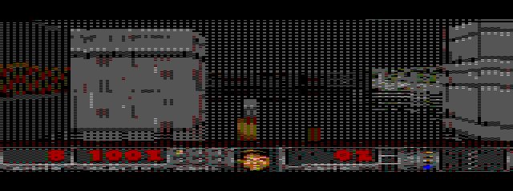

# DOOM on the CoCo 3

Freedoom's E1M1 running on a **Tandy Color Computer 3** (a 1.79 MHz 6809, the GIME video chip, 2 MB). It has the
real level layout, real wall art, DOOM's lighting and status bar, four kinds of monster, and sound.



All game data comes from [Freedoom](https://freedoom.github.io/) (BSD licence), read straight from its source
checkout in `freedoom/`. Nothing is taken from id Software's commercial data, so the disk can be shared. This is
an unofficial fan project, not affiliated with id Software.

This is **Stage A** of [docs/PLAN.md](docs/PLAN.md). The level is rasterised onto a grid of 64-unit cells, and the
floors are flat. Stage B (real sectors, with heights) is planned there.

## Play it
```
./setup.sh      # once: lwtools, MAME, Python, and the Freedoom checkout; checks the CoCo 3 ROMs
./run.sh        # builds the disk, boots a CoCo 3 in MAME, types LOADM"DOOM":EXEC for you
```
The whole game fits on one standard 35-track Disk BASIC disk (`build/DOOM.DSK`, 54 of its 68 granules). Loading,
plus building the pages and column routines at boot, takes about 90 seconds of CoCo time; MAME runs that part
unthrottled.

| Key | Action |
|---|---|
| **W / UP**, **S / DOWN** | forward / back |
| **A / LEFT**, **D / RIGHT** | turn |
| **SPACE** | open a door, press the exit switch |
| **CTRL** or **F** | fire |
| **T** | let the computer play (the autopilot, in red vision) |
| **BREAK** | back to BASIC |

`cocodoom.mp4` is 30 seconds of the autopilot playing E1M1, recorded with `./run.sh --video cocodoom.mp4 --demo 30`
(frame-exact: MAME writes every emulated frame). `make test` runs the checks (below), and `make bench` measures the
frame rate.

## What's in it
* **E1M1's layout.** `scripts/grid.py` puts every 8-unit point of the map into one of three classes (open, door
  or rock) by walking DOOM's own BSP to a subsector, then testing it against that subsector's segs, which tells
  floor from the void behind a wall. Each 64-unit cell takes the majority class. Thin walls between rooms are
  restored, and a wall cell takes the texture of the sidedef that faces open space. Steps don't block: the grid
  has one floor height, and E1M1 starts on a platform 140 units above its corridor.
* **DOOM's proportions.** Walls are 128 units tall on 64-unit cells, with the eye at mid-height. A wall taller
  than the view isn't squashed. One of 26 extra column classes shows only the part of the texture the view can
  hold, so near walls grow the way DOOM's do.
* **DOOM's lighting.** Each cell carries its sector's light. Rays fetch it from a light page, add DOOM's distance
  brightening (`scalelight`), and make y walls one band darker (DOOM's fake contrast). Each of the 8 light bands
  is its own texture page, darkened through Freedoom's own COLORMAP, so changing the light costs only a different
  page choice.
* **Monsters** (zombiemen, shotgun guys, imps and demons, each with its own frames and hit points), pickups (from
  stimpacks and medikits to keycards and the soulsphere), barrels and decor, and the fist, pistol, shotgun and
  chaingun in your hands, all placed where E1M1 puts them.
* **DOOM's status bar,** composed from STBAR with its digits, ARMS panel, keys and faces.
* **Sound:** Freedoom's sound effects through the 6-bit DAC, at about 3,900 samples a second.

## The impossible part: a polished floor
Look at the floor under the walls, the monsters and the barrels in `cocodoom.mp4`: everything is **mirrored in it,
in real time**, while you walk and turn. DOOM itself never had floor reflections.
On a 1.79 MHz 8-bit CPU with an 8×8 multiply and no divide, that should cost a second render pass. It costs **0.6%**:
15.9 fps with reflections, 16.0 without (`make bench`, `DOOM_REFLECT=0` to turn them off).

The trick is the same one as for division and sine: decide it once, ahead of time. The engine compiles one
drawing routine per wall height at boot. Under each wall, the floor rows that routine paints simply read the
wall's own texels *backwards*, every other row near the wall's foot and one row in four farther down, between
rows of the floor's own colour. The eye blends that into a 50%, then 25%, glossy reflection. The reflection's
height, its texel steps (a Bresenham walk run backwards) and where it fades are all fixed in the instruction
stream. At run time a reflected row is one extra `LDA` in a routine that was going to store that row anyway.
Monsters, pickups and decor get the same treatment beneath their feet, and their transparent pixels are kept,
so a zombie reflects as a zombie, not a rectangle.

## The tricks
* **Colour from blends, chosen for blends.** The 16 GIME colours (of 64) are chosen by what their 2×2 Bayer
  mixtures can show of E1M1's art at the light levels the map actually uses. Mixes are averaged in linear light,
  the way an RGB monitor blends dots, and errors are measured in OKLab with hue counted four times. With blends,
  the colour error is 47% lower than with the 16 colours alone (`scripts/palette.py`).
* **A dither locked to the screen, for free.** Each frame paints rows of only one parity (the interlace inherited
  from the Wolfenstein engine), so the dither phase is just a page choice: even frames read phase-0 pages, odd
  frames phase-1. Moving walls don't shimmer, and the column routines are unchanged.
* **The boot is the build.** The disk doesn't carry finished pages. It carries the texels as DOOM palette
  numbers, column by column, in a lossy run-length code: a texel joins the run above it when the two colours
  are within a small perceptual distance (`DOOM_RLE_TAU`), and transparency never merges. That's 126 KB down to 44 KB (35%). At boot the CoCo unpacks each
  stream and writes all 16 wall pages (8 light bands × 2 phases) and 14 figure pages. Each byte is one lookup per
  pixel into two tables (`HI[left] | LO[right]`), stored with index XOR $80 so the 6809's signed `LDA A,Y` reaches
  all 256 entries.
* **Trust nothing you haven't diffed.** `scripts/gen_assets.py` writes the Python twin of every forged page.
  `make test` reads all 30 pages back out of the emulated CoCo's RAM, and they match byte for byte.
* **Inherited from the Wolfenstein 3D engine** (the sibling project): no division at run time, column routines
  compiled at boot, the GIME memory mapper, stack-blasted fills, interlaced rows and a speed governor.

## Measured
* 15.9 frames per second while moving with 40 strips (16.0 without the reflections), averaged over a full turn at four spots on the map (12 to
  19.5 depending on the view; `screenshots/fps.txt`). The governor keeps full detail down to about 14 fps.
* Boot-forged pages identical to the Python twin: 30 of 30.

## Limits
* Stage A: one floor height, a 64-unit grid (diagonal walls become steps), one texture per wall cell (the first
  64 units of each DOOM texture), 12 wall textures plus the switch and two doors (E1M1's other textures borrow the
  closest-looking one).
* The floor and ceiling are each one flat's colour, fading with distance, not textured.
* Monsters show their front view only. Imps and demons shoot like zombiemen, and there's no armour.
* One sound at a time. MAME's tests run without sound, so the sound has only been checked by building it.
* Tested in MAME only so far; it hasn't been tried on a real CoCo 3.

## Files
```
doom.asm            the engine: loader, page forge, column compiler, ray caster, figures, status bar, sound
code2.asm           game logic and the autopilot (its own memory map)
dp.inc              the shared variables, with a glossary
scripts/            wad.py (Freedoom reader), grid.py (map -> lattice), palette.py, dither.py, rle.py,
                    gen_assets.py (everything -> tables), sounds.py, mkdat.py, mkdsk.py, bench.sh
test/               MAME harness (scripted keys, screenshots, page dumps), run_tests.sh
docs/PLAN.md        the plan: budgets, the LUT techniques, Stage B
```
The other folders here (`wolf3d/`, `cubes/`, `fractals/`, `nsx6809/`) are local reference copies of the sibling
projects, ignored by git (the originals sit beside `doom/`).
