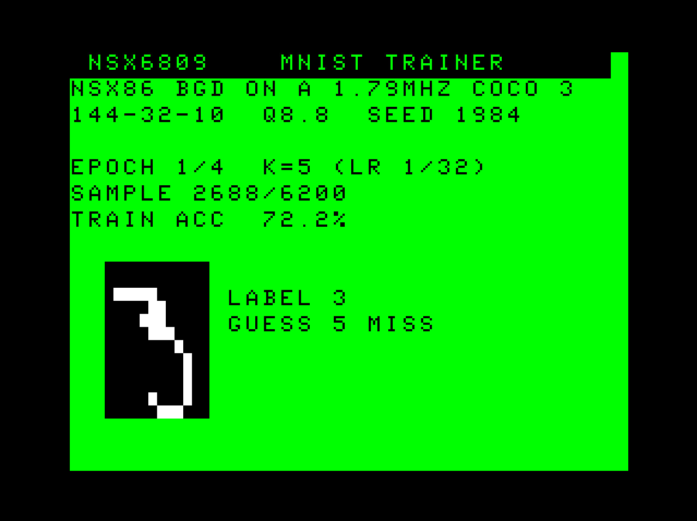

# NSX6809 — a CoCo 3 that learns to read handwriting

Draw a digit with the keyboard or a joystick, press ENTER, and a CoCo 3 tells you which digit it is. Nothing is
pre-programmed about what a "7" looks like. The CoCo **learned it**, on its own CPU, from 6,200 examples of
handwriting, in 35 minutes.

This is the same basic recipe behind today's AI, at a size a 1986 home computer can run. It uses no floating
point, one division per example, and no hardware that didn't exist then: a 6809, 512 KB, a floppy disk, and
integer arithmetic a CoCo programmer would recognise.




## Try it
```
./get_mnist.sh       # once: download MNIST, the classic 70,000 handwritten digits (into data/)
./run.sh --train     # the CoCo learns (35 minutes of CoCo time; MAME does it in about a minute and a half)
./run.sh             # draw digits and let the CoCo read them
test/verify.sh       # check the CoCo's work against a Python copy, byte for byte
```
You need `lwasm` (lwtools 4.x), MAME with the CoCo 3 ROMs, and Python 3.

## Two disks: one learns, one uses what was learned
| Disk | What it does |
|---|---|
| **MNSTTRN.DSK** | **Learning.** Loads 6,200 example digits from the disk and goes through them four times. After each pass it tests itself on 1,000 digits it has never seen, then saves what it learned to **MODEL.NSX** on the same disk. You can watch each example, the right answer and the CoCo's guess. |
| **MNSTINFR.DSK** | **Using it.** Loads MODEL.NSX, and you draw. |

`./run.sh --train` copies MODEL.NSX from the first disk to the second for you. On a real CoCo 3, with the learning
disk in drive 0 and the drawing disk in drive 1:
```
KILL"MODEL.NSX:1"
COPY"MODEL.NSX:0"TO"MODEL.NSX:1"
```

## The drawing program
| Key | Action |
|---|---|
| **W A S D** or the **right joystick** | move the brush |
| **SPACE** or the **joystick button** | ink |
| **X** | rub out |
| **CLEAR** | wipe the picture |
| **ENTER** | "what digit is this?" — the answer, the top three guesses and how sure it is |
| **LEFT / RIGHT** | page through up to **16 drawings** kept in memory (past the last one you get a fresh page) |
| **0–9** | load a real handwritten example of that digit (press again for the next one) |
| **BREAK** | back to BASIC |

It starts with three random handwritten digits already loaded. The screen is 320×192 in 4 shades of grey. The
lettering is the CoCo 3's own `HPRINT` font, borrowed from ROM.

## What "learning" means here, in 6809 terms
Strip away the vocabulary and it's arithmetic on a table of numbers.

* **The picture.** Your drawing is shrunk to 12×12 dots, each on or off: 144 bits.
* **The "network"** is two tables of 16-bit numbers (fixed point, 8 bits of fraction):
  * **144 × 32** in the first table. For each of 32 "feature detectors", add up the numbers belonging to the dots
    that are on. A detector that ends up below zero counts as zero. With on/off dots this step is **only additions**.
  * **32 × 10** in the second table. Each digit 0–9 gets a score: a weighted sum of the 32 detectors (`MUL` does
    the weighting).
  * The highest score is the answer.
* **Learning** is how those 4,970 numbers get their values. They start as random noise.
  1. For every example, compute the scores.
  2. Turn them into "how sure" figures with a table of e^−x values.
  3. Then, for every number in the tables, work out which way and how far to nudge it so that the right digit
     would have scored a little higher.

  That's the whole method behind modern AI: guess, measure the error, nudge every number a little, repeat.
* **Bresenham Gradient Descent.** The nudges are usually fractions far smaller than one step of a 16-bit number.
  So each number keeps a small "carry" byte, exactly like the error term in Bresenham's line algorithm. Fractions
  pile up in the carry, and when it spills over the number moves by a whole step. Nothing is lost to rounding, and
  it all runs in integers.
* **Memory.**
  * The learned numbers fill 10 KB, sitting in two 8 KB memory pages.
  * The examples fill 137 KB more.
  * Everything moves on and off the floppy through Disk BASIC's own `DSKCON` routine, which reads the directory
    and the allocation table itself, so MODEL.NSX is rewritten in place.

## How well it does
| | |
|---|---|
| Right answers on 1,000 test digits it never saw | **88.5%** (after each pass: 84.3, 86.5, 88.3, 88.5) |
| Right answers on all 10,000 MNIST test digits | **90.2%** |
| Time to learn on a 1.79 MHz CoCo 3 | 35 minutes |
| The CoCo's MODEL.NSX vs the Python copy's | **identical, byte for byte** |
| Drawing program vs the Python copy | identical results on every test, and all right: the ten digits, a 7 drawn with the keys, a 1 drawn with the joystick |

90% isn't a record, but it's what this little network gets on any computer. The same recipe with bigger tables,
more examples and faster machines is what the AI news is about.

## Why "NSX"
It grew out of NSX86 (Neural Splines for the 8086), an earlier experiment by the same author. It keeps NSX86's
choices: 8.8 fixed point everywhere, the Bresenham-style learning rule, NSX86's random-number generator and seed
(1984), its exp table, and its model-file header. One thing had to change. NSX86's original layer gave each neuron
only two weights (one for all the even-numbered dots, one for all the odd ones), which can't tell digits apart; that
caps it at about 21%. Here every dot has its own weight.

## Licence and patents
The code is under the Clear BSD License ([LICENSE](LICENSE)). **The methods are patented.** Neural Splines technology, including
the Bresenham Gradient Descent learning rule this project is built on, is protected by patents and pending patent
applications of Neural Splines LLC, and the licence itself states that it grants no patent rights. You're welcome to read, build, run,
study and change it for **personal, hobby, educational and non-commercial research** use. Commercial use, or building
the method into another product, needs a licence: see [PATENTS.md](../PATENTS.md).

## Files
```
nsx6809.inc          shared: model layout, disk access (directory, allocation table, page by page), random numbers,
                     the scoring pass, the "how sure" step, division, text
mnsttrn.asm          the learning program (MNSTTRN.BIN, 3.9 KB)
mnstinfr.asm         the drawing program (MNSTINFR.BIN, 4.7 KB)
tools/nsxdata.py     turns MNIST into the CoCo's data files; the Python copy of the network and of the learning
tools/dsk.py         disk images: make one, list it, copy a file in or out
get_mnist.sh         downloads MNIST
build.sh  run.sh     build both disks; learn / draw in MAME
test/verify.sh       the byte-for-byte checks
screenshots/         taken during those checks
```
