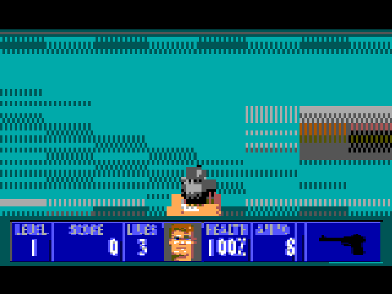

# Wolfenstein 3D on the CoCo 3

Wolfenstein 3D (the real first level, the real wall art, the real status bar and BJ's face) running full-screen on a
**Tandy Color Computer 3**: a 1.79 MHz 6809 with the GIME video chip and 2 MB of memory.



> **You need to own the game.** This folder contains **none of id Software's data**. The build reads the art, the map
> and the sounds from your own copy of Wolfenstein 3D v1.4 (the full version's `*.WL6` files). See
> [NOTICE.md](NOTICE.md). If you don't have the game, `./release.sh` builds a playable version with original stand-in
> art instead (see below). This is an unofficial fan project, not affiliated with id Software.

## Play it
```
./setup.sh      # once: installs the assembler (lwtools), MAME and Python, and checks the CoCo 3 ROMs
./run.sh        # builds the disk, boots a CoCo 3 in MAME, types LOADM"WOLF3D":EXEC for you
```
On a real CoCo 3 (2 MB), put `build/WOLF3D.DSK` on a floppy or CoCoSDC and type `LOADM"WOLF3D":EXEC`.
While it loads (about a minute) a rainbow cover page shows on screen.

| Key | Action |
|---|---|
| **W / UP**, **S / DOWN** | forward / back |
| **A / LEFT**, **D / RIGHT** | turn |
| **SPACE** | open a door, press the elevator switch |
| **CTRL** or **F** | fire |
| **T** | let the computer play (the "terminator" autopilot, in red vision) |
| **BREAK** | back to BASIC |

`demo.mp4` is 30 seconds of the autopilot playing, recorded with `./run.sh --video demo.mp4 --demo 30 --start level`.

### No game files? Play the stand-in
`./release.sh` builds **Ashen Bastion**: the same engine with original walls, enemies, status bar, a small level and
made-up sound effects, nothing taken from the game. `./run.sh --release` plays it. That disk can be shared freely.

## What's in it
* **The real game data**, pulled out of your files at build time by `scripts/wolfai.py`. It understands the
  game's compressed formats (the packed executable for the palette, the wall/sprite file, the maps, the
  compressed pictures).
* **Textured walls** (15 textures, each with a darker version for north-south walls), doors, the elevator, and
  sliding along walls.
* **Enemies and pickups**: guards that wake, chase, shoot and die; food, first aid, ammo, treasure, extra lives,
  the machine gun and chain gun, gold and silver keys, and the knife when you're out of ammo.
* **Sound**: the original sampled guns, "Halt!", death screams and doors, and the PC-speaker pickup jingles, played
  through the CoCo's 6-bit DAC about 3,900 times a second.
* **An autopilot** (`T`) that finds its way to the elevator, opens doors, aims at guards it can see, shoots them,
  finishes the level and starts again.

## How a 1.79 MHz CoCo keeps up
* **No division at all while playing.** Everything that would need one (how far a ray travels per map square, how
  tall a wall looks at a given distance) is looked up in tables built ahead of time.
* **The program writes its own drawing code.** At start-up it generates about 150 small routines, one for each wall
  height and strip width. Each draws a whole column (ceiling, wall texture, floor) as a straight run of store
  instructions, with no loop and no lookups. Drawing a wall column is a single `JSR`.
* **2 MB through a small window.** Those routines and the textures live in memory pages beyond 64 KB; the GIME's
  memory mapper (MMU) swaps the right page into view with one write.
* **Moving 6 bytes at a time.** `PULS` and `PSHU` with four registers copy 6 bytes in 22 cycles. Measured: 3.5×
  faster than a byte loop and 2× faster than a 16-bit one (`test/bench_blast.sh`). Used for the status bar and the
  floor/ceiling fill.
* **Draw less, not slower.**
  * Each frame redraws every other screen row, alternating. When you stop, the picture sharpens over two frames.
  * Strips are 2 pixels wide when standing and 4 when moving.
  * If frames get slow, the program drops to wider strips, and in the worst case to one row in four, then climbs
    back when it can.
* **Not everything every frame.** The keyboard is read every other frame, the autopilot thinks every other frame,
  and the full list of visible objects is rebuilt every fourth frame.
* **Colour tricks.** The floor's stripes swap two palette colours every frame while you move, so the floor seems to
  stream past for the price of two register writes.
* **One 16-colour palette for the whole game**, picked by testing all 64 GIME colours against every wall, sprite
  and the status bar.

Measured speed in the busiest spots of the level: 19–24 frames per second with walls and enemies, 30 in the
fallback mode, and about 26 in normal play (`screenshots/fps.txt`).

### Sound, in a little more detail
The CoCo 3 has no sound chip, so the CPU plays every sample. A GIME timer interrupts every 4 scanlines. The
interrupt copies one byte from a 256-byte ring buffer to the DAC, about 50 cycles all told, roughly 11% of the CPU
while a sound plays and nothing when silent. The game refills the ring between frames.

The sampled sounds are resampled to the CoCo's rate when the disk is built. The PC-speaker jingles aren't stored
as sound at all: the disk keeps their original note lists (2.9 KB), and the CoCo plays them back into 40 KB of samples
at start-up.

### Loading
`LOADM` only brings in a 6 KB loader. The loader then reads the rest (textures, map, tables, status bar) sector by
sector with Disk BASIC's own `DSKCON` routine, straight into high memory. Two traps learned the hard way:
* the BASIC ROM disappears if you remap the top half of memory while loading;
* `DSKCON` comes back with interrupts switched on.

`scripts/mkdsk.py` writes disk images laid out exactly as real Disk BASIC lays them out.

## Limits
* First level only. Brown guards only, no secret push-walls, and the guards' AI is simple.
* One sound at a time, 6 bits, about 3.9 kHz: the treble is gone, and gunshots cut each other off as in the
  original.
* 16 colours: some textures (wood, banners) are recognisable but blocky.
* Loading reads one sector per disk turn, so it takes about a minute.

## Files
```
wolf3d.asm          the engine: loader, code generator, ray caster, sprites, status bar, input
code2.asm           game logic and the autopilot (runs in its own memory map)
dp.inc              the shared variables, with a glossary (see below)
scripts/            game-data extraction (wolfai.py), table and palette building, sound, disk images
test/               drive the real disk in MAME with scripted keys, take screenshots, measure speed
screenshots/        those screenshots and measurements
docs/MARIO_PLAN.md  notes on how Super Mario Bros. could be done the same way
```

### About the odd names in the source
The source is written as field notes by a visitor who has never seen a computer game: the screen is *the glass*, a
frame is *a breath*, the vertical blank is *the tide*, the player is *the traveller*, guards are *sentinels*, and
health is *vitality*. `dp.inc` starts with a glossary that maps every one back to the usual word. The renaming was
checked: the program assembled to the same bytes before and after.
